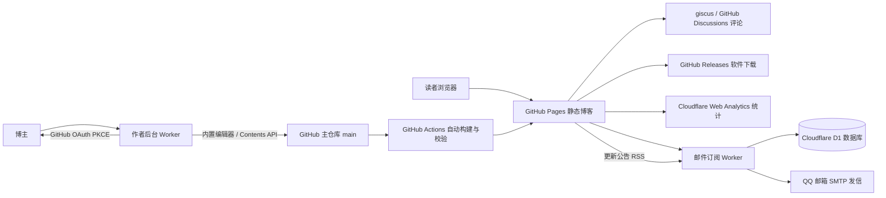

很多人想搭个人博客时，第一反应是买一台云服务器、装数据库、配 Nginx 和 HTTPS。但我最后选了一套**零服务器费用、免运维，却依然拥有独立写作后台、邮箱订阅推送、软件下载站和评论区**的方案。

这篇文章把我现在这个博客**用了哪些东西、整体怎么连起来的、前端 UI 怎么改的，以及从零复刻的步骤**一次性整理出来，既当成自己的建站档案，也给想搭同款博客的朋友做个参考。

---

## 一、整体架构一览

整套博客的核心思路是：**静态内容走 GitHub Pages，动态能力按职责拆成轻量 Cloudflare Workers**。

这套拆分的优点很明显：
- **博客主站 100% 静态化**：访问快、几乎不可能挂、不需要维护服务器和数据库；
- **写作后台与主站隔离**：公开仓库只放文章与公开样式，受保护的管理页面与 GitHub 鉴权独立跑在 Cloudflare Worker 上；
- **订阅邮件完全自主**：读者无需注册第三方订阅平台账号，确认与退订全中文。

---

## 二、完整技术栈与免费服务清单

| 模块 | 使用的技术 / 服务 | 作用与特点 |
|---|---|---|
| **博客框架与主题** | [Jekyll](https://jekyllrb.com/) + [Chirpy 7.6](https://github.com/cotes2020/jekyll-theme-chirpy) | 成熟稳定，原生支持目录（TOC）、归档、分类/标签、公式（MathJax）、Mermaid 流程图、搜索和 PWA |
| **托管与自动发布** | GitHub Pages + GitHub Actions | 每次提交到 `main` 自动构建，并运行 `HTML-Proofer` 检查站内死链和图片错误 |
| **视觉与交互定制** | 原生 CSS 变量 + 轻量 JS（无额外前端框架） | 融合 **iOS 26 Liquid Glass** 与 **POETIZE** 氛围布局，支持浅/深色切换与移动端底部悬浮 Tab Bar |
| **作者登录与内置写作台** | Cloudflare Workers + GitHub OAuth (PKCE) + GitHub Contents API | 服务端按固定 GitHub 数字 ID 放行，内置浅色 Markdown 分栏编辑器，支持粘贴截图自动上传 |
| **备用可视化编辑器** | Pages CMS（`.pages.yml`） | 保留作为备用可视化写作入口，与内置编辑器共用同一套 YAML front matter 规范 |
| **邮箱订阅与更新推送** | Cloudflare Workers + Cloudflare D1 + Cron Triggers + QQ SMTP | 邮箱二次确认防扫描、每 5 分钟轮询公告 RSS、每日发信预算控制与投递去重 |
| **软件下载中心** | GitHub Releases + 构建期目录脚本 | 安装包托管在固定 Release，构建时自动生成静态清单，前端支持实时搜索、复制 Markdown 链接与 SHA-256 校验 |
| **文章评论区** | [giscus](https://giscus.app/)（基于 GitHub Discussions） | 无广告、免后端、按文章路径自动创建讨论 |
| **访问统计** | Cloudflare Web Analytics | 轻量无 Cookie 统计，查看访问量、热门文章与来源 |

---

## 三、核心模块是怎么搭建的

### 1. 静态博客主站与自动化发布（GitHub Pages + Actions）

博客基于 Chirpy 主题起步，重点做了几件基础工程配置：
1. **统一时区与文章规范**：`_config.yml` 设置 `timezone: Asia/Shanghai`，所有文章采用 `/posts/:title/` 固定链接，front matter 统一包含 `title`、`date (+0800)`、`description`、`categories`、`tags`、`comments`、`pin`、`math`、`mermaid`。
2. **自定义自动化工作流**：GitHub Actions 在每次推送 `main` 时依次完成：
   - 拉取软件下载 Release 清单，生成静态 JSON 兜底；
   - 执行 `jekyll build` 生产构建；
   - 运行 `htmlproofer --disable-external` 校验全部 HTML 文件的站内链接与图片；
   - 自动部署到 GitHub Pages。
3. **空封面防错插件**：加了一个极简 Jekyll 插件，当文章未填写 `image` 或为空字符串时自动清理，避免主题生成损坏的图片地址。

---

### 2. 前端 UI 改造：POETIZE 氛围 × iOS 26 液态玻璃

为了让博客既耐看又好维护，我没有换掉 Jekyll，也没有引入 Vue/React 重构，而是直接通过覆写 `_layouts/home.html`、`_includes/topbar.html`、`_includes/footer.html` 与 `assets/css/morning.css` 完成整站换肤：

- **遵循 iOS 26 Liquid Glass 双层规范**：
  - **顶层导航层**：顶部拆分为两枚悬浮液态玻璃胶囊（左：品牌与分段导航；右：搜索胶囊、SVG 日夜切换与低调后台入口），移动端额外提供底部悬浮液态玻璃 Tab Bar；
  - **底层内容层**：浅色 `#F2F2F7` 分组底 + 纯白 `#FFFFFF` 大圆角卡片，深色 `#000000` 纯黑底 + `#1C1C1E` 实体卡片，绝不“玻璃叠玻璃”，保证长文阅读清晰度。
- **融入 POETIZE 氛围感布局**：
  - 首页顶部采用本地高清封面图 + 打字机动态诗句 + 3 层流动 SVG 波浪过渡，浅/深色自动切换不同遮罩；
  - 首页正文采用经典左右双栏：左侧粘性「博主资料卡（本地化头像 + 悬停旋转 + 文章/分类/标签统计 + 订阅与 GitHub 胶囊）」「站点公告」「热门标签云」，右侧「★ 置顶精选卡」+「iOS 内嵌分组文章列表」；
  - 页脚加入渐变细装饰条与实时「本站已安静运行 X 天」计时。
- **细节与性能打磨**：
  - 头像、头图与站点图标（SVG + PNG + ICO + Apple Touch Icon）全部**本地化**进仓库，避免外链图床或第三方 CDN 抖动导致裂图；
  - 下载页按文件扩展名自动着色（`EXE / ZIP / APK / JS` 等）并带复制成功即时反馈。

---

### 3. 独立作者后台与内置 Markdown 写作台

为了避免把管理页面暴露在公开静态站，也摆脱第三方编辑器外观不可控的问题，我把作者后台做成了独立的 **Cloudflare Worker**：

1. **严格的身份与权限隔离**：
   - 主站 `/admin/*` 仅保留跳转入口，真正的后台页面托管在作者 Worker 的私有静态资源中，且开启 `assets.run_worker_first = true`，任何未登录请求都会在进入静态资源前被拦截并返回 `401` 与 `Cache-Control: private, no-store`；
   - 登录采用标准 **GitHub OAuth + PKCE + state**，只申请公开身份，服务端核对固定的作者数字 ID 后才签发 `HttpOnly; Secure; SameSite=Lax` 的 8 小时签名会话 Cookie。
2. **内置浅色 Markdown 写作台（`/admin/editor/`）**：
   - 外观与首页保持完全一致的大肥鱼浅色 iOS 26 风格；
   - 支持直接切换管理「公开文章」「更新公告」「关于我」，左侧实时读取文章真实中文标题并支持搜索；
   - 支持纯编辑 / 左右分栏实时预览 / 纯预览，正文里可直接 **`Ctrl+V` 粘贴截图**自动上传到 `assets/img/uploads/`；
   - 写入权限通过 Cloudflare Secrets 里的**单仓库最小权限 Fine-grained Token**（仅开启博客仓库的 `Contents: Read and write`）在服务端代理完成，令牌永不进入前端代码或浏览器存储，所有写入接口同时校验同源 `Origin` 与路径白名单。

---

### 4. 零平台依赖的邮箱订阅与更新推送

不想让读者为了订阅再去注册某个平台账号，所以我单独写了一个 **Newsletter Cloudflare Worker + D1 数据库**：

- **分离订阅源**：普通文章修改和软件上传不会打扰读者；只有作者在 `_updates/` 发布正式公告后，才会进入专用的 `/updates/feed.xml`；
- **防误触与防滥用**：读者提交邮箱后会收到中文确认邮件，点击确认页按钮（POST）才正式激活，防止邮箱安全扫描器自动误订阅；同时对单邮箱和来源做频率限制；
- **定时投递与预算控制**：通过 Cloudflare Cron 每 5 分钟检查一次更新公告 RSS，经由 QQ 邮箱 SMTP（465 TLS）分批发送，并依靠数据库唯一约束做投递去重。

---

### 5. 软件下载站、评论与统计

- **软件下载中心**：在 GitHub 仓库建立一个固定标签的 Release 用来存放安装包（单文件上限 2 GiB）；每次编辑 Release 时自动触发 GitHub Actions 刷新博客静态下载清单，前端页面既支持实时搜索和复制文章内 Markdown 下载链接，也支持查看 SHA-256 校验值。
- **留言评论**：在仓库开启 Discussions 后直接接入 giscus，按文章 `pathname` 严格映射，几乎零维护。
- **访问统计**：接入 Cloudflare Web Analytics，后台保留直达统计面板的入口。

---

## 四、如果你想照着搭一套：5 步路线图

1. **第一步：跑通基础博客**
   - 用 Chirpy 模板创建 `<你的用户名>.github.io` 仓库，配置 `_config.yml` 和 GitHub Pages Actions，先发出一篇 `Hello World`。
2. **第二步：定制自己的 UI**
   - 覆写 `_layouts/home.html`、`_includes/topbar.html` 和自定义 CSS，确定浅/深色变量体系，把头像、头图和 Favicon 全部放进本地 `assets/img/`。
3. **第三步：加上评论、统计与下载页**
   - 开启 GitHub Discussions 配置 giscus；接入 Cloudflare Web Analytics；建一个固定 Release 存放分享文件。
4. **第四步：部署作者后台 Worker**
   - 在 GitHub 创建 OAuth App，部署带 `run_worker_first = true` 的 Cloudflare Worker；把单仓库细粒度 PAT 存进 Worker Secrets，解锁专属网页 Markdown 编辑器。
5. **第五步：按需加上独立邮件订阅 Worker**
   - 创建 Cloudflare D1 表结构，配置邮箱 SMTP 授权码与 Cron 定时任务，打通更新公告 RSS 到邮件推送的闭环。

---

## 五、建站过程中最值得记住的 5 条经验

1. **把“三个部署对象”分清楚**：博客主站（GitHub Pages）、作者后台 Worker、邮件订阅 Worker 是彼此独立的——推代码到 `main` 只会发布博客，改了 Worker 代码要单独 `wrangler deploy`。
2. **关键资源尽量本地化**：头像、头图、站点图标都放进仓库，不依赖外部免费图床，打开速度和稳定性会好非常多。
3. **坚持最小权限原则**：GitHub Token 只勾单个仓库、只开 `Contents` 读写，所有密钥只放 Cloudflare Secrets，绝不写进仓库或前端代码。
4. **保留自动化检查**：每次发布都跑 `HTML-Proofer`，能提前拦住拼错的站内链接、坏掉的图片路径和格式问题。
5. **先小步跑通，再逐步打磨**：先把写作和发布闭环跑顺，再去叠加视觉动效、内置编辑器和订阅推送，整个博客就会一直保持清爽、好维护的状态。
